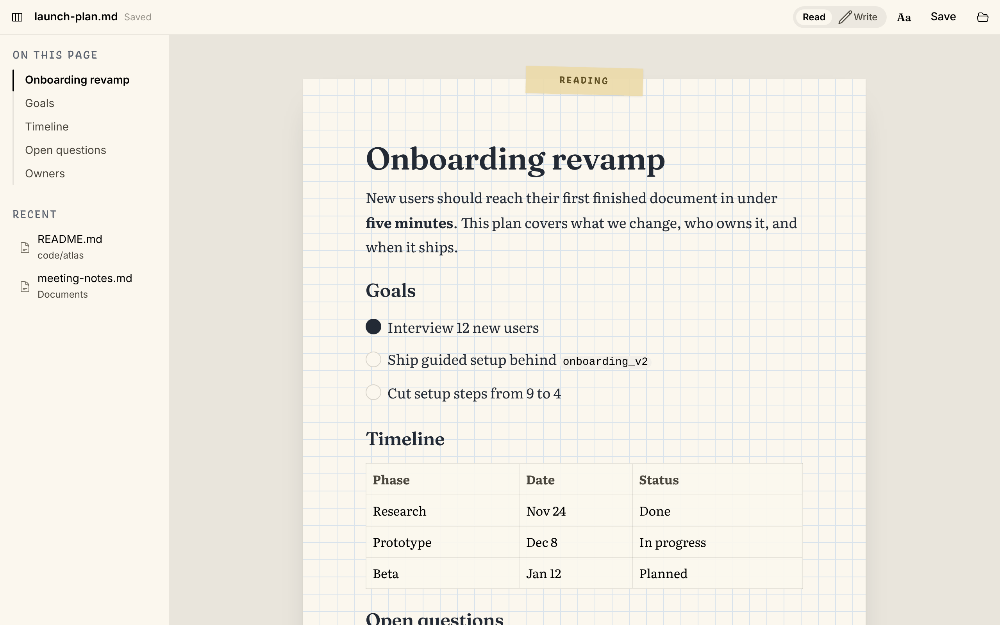

<p align="center">
  
</p>

<h1 align="center">Notr</h1>

<p align="center">Open, read and edit Markdown files without knowing Markdown.</p>

<p align="center">
  <a href="../../releases/latest"><b>Download for Mac</b></a>
</p>



Notr opens any `.md` file as a clean, readable page. When you want to change something, switch to **Write** and edit it like a normal document: add titles, lists, to-dos, tables and quotes from the tray or by typing `/`. Notr saves plain Markdown back to the same file, front matter included.

## Features

- **Read and Write modes.** Press `E` to start writing and `Esc` to go back to reading. Your scroll position stays put.
- **No Markdown syntax to learn.** Headings, checklists, tables, code blocks and links are all point and click.
- **An outline of every page** so long documents are easy to move around.
- **Paper and type settings:** grid, lined or plain paper, and adjustable text size.
- **A real Mac app.** Native windows and menus, autosave, Versions (File > Revert To), Open Recent, and "Open With" from Finder. You can make Notr your default app for Markdown files.
- **Works offline.** Nothing leaves your Mac.

## Install

1. Download the latest `Notr-x.y.z.dmg` from [Releases](../../releases/latest).
2. Open it and drag **Notr** into **Applications**.
3. Open Notr from Applications.

Notr needs macOS 13 Ventura or later and runs natively on Apple silicon and Intel.

### "Apple could not verify Notr"

Unless a release says it is notarized, it is built by GitHub Actions without a paid Apple Developer ID, so macOS blocks it the first time you open it. To allow it once:

1. Open Notr and click **Done** in the warning.
2. Go to **System Settings > Privacy & Security**, scroll down and click **Open Anyway** next to the message about Notr.
3. Confirm with your password.

Or run this in Terminal after copying Notr to Applications:

```bash
xattr -dr com.apple.quarantine /Applications/Notr.app
```

### Make Notr your default Markdown app

In Finder, select any `.md` file, choose **File > Get Info**, pick **Notr** under **Open with**, then click **Change All**.

## Build from source

You need Node.js 22, and for the Mac app, macOS with Xcode 16 or later and [XcodeGen](https://github.com/yonaskolb/XcodeGen) (`brew install xcodegen`).

```bash
git clone https://github.com/babakuzo/markdown-editor.git
```

```bash
cd markdown-editor
```

| Command | What it does |
| --- | --- |
| `make dev` | Runs the editor in your browser at http://localhost:3000. Fastest way to work on the UI. |
| `make app` | Builds the web editor and `build/Release/Notr.app`. |
| `make dmg` | Builds the app and packages `build/Notr-<version>.dmg`. |
| `make open` | Builds the app and opens it. |
| `make clean` | Removes all build output. |

To work on the Swift side in Xcode, run `make web project` once, then open `mac/Notr.xcodeproj`. Run `make web` again whenever you change the web editor.

## How it works

Notr is two parts:

- **The editor** (`src/`) is a Next.js app built as a static, offline bundle. It uses [Astryx](https://github.com/meta/astryx) components for the interface and [Lexical](https://lexical.dev) for rich text editing. It also runs on its own in a browser, where it opens files by drag and drop and saves by downloading.
- **The Mac app** (`mac/`) is a small SwiftUI document app. It owns the windows, menus, file access, autosave and Versions, and hosts the bundled editor in a `WKWebView`.

They talk over a tiny bridge:

| Direction | Message | Purpose |
| --- | --- | --- |
| Mac to editor | `window.notrOpen({name, folder, markdown})` | Show a file. Sent on open, and again after Undo from the menu bar or when the file changes on disk. |
| Editor to Mac | `{type: "changed", markdown}` | The page was edited. Marks the window as edited so macOS autosaves it. |
| Editor to Mac | `{type: "save", markdown}` | The user pressed Save or Cmd+S. |

```
.
├── src/                    Web editor (Next.js, Astryx, Lexical)
│   ├── notr/              The app: Notr.tsx, editor plugins, sample files
│   └── themes/notr/       Built Astryx theme
├── themes/notr/           Theme source for the Astryx theme editor
├── mac/
│   ├── project.yml         XcodeGen spec (the .xcodeproj is generated)
│   ├── Notr/              SwiftUI app, Info.plist, app icon
│   └── design/icon.svg     App icon source
├── scripts/                DMG packaging, signing and notarization
└── .github/workflows/      CI and release builds
```

## Releasing

Bump `version` in `package.json`, commit, then push a tag:

```bash
git tag v0.2.0
```

```bash
git push origin v0.2.0
```

The **Release** workflow builds a universal `Notr.app` on a macOS runner, packages `Notr-0.2.0.dmg` with a SHA-256 checksum, and publishes a GitHub release. You can also run it by hand from the Actions tab, which creates a draft release.

### Signed and notarized releases

With an [Apple Developer Program](https://developer.apple.com/programs/) membership, releases can be signed and notarized so they open without any warning. Add these repository secrets under **Settings > Secrets and variables > Actions**:

| Secret | Value |
| --- | --- |
| `MACOS_CERTIFICATE` | Your **Developer ID Application** certificate exported as `.p12`, then base64 encoded (`base64 -i cert.p12 \| pbcopy`) |
| `MACOS_CERTIFICATE_PASSWORD` | The password you set when exporting the `.p12` |
| `SIGNING_IDENTITY` | The certificate name, e.g. `Developer ID Application: Your Name (TEAMID)` |
| `APPLE_ID` | The Apple ID email for your developer account |
| `APPLE_TEAM_ID` | Your 10 character team ID |
| `APPLE_APP_PASSWORD` | An [app-specific password](https://support.apple.com/102654) for that Apple ID |

When `MACOS_CERTIFICATE` is set, the workflow signs with hardened runtime, notarizes the disk image with Apple and staples the ticket. Without it, builds are ad-hoc signed.

You may also want to change the bundle identifier (`app.notr.Notr` in `mac/project.yml`) to one under a domain you own.

## Contributing

Issues and pull requests are welcome. Please run `make dev` to check UI changes in a browser and `make app` to check the Mac build before opening a pull request. CI builds both on every pull request.

## License

[MIT](LICENSE). Notr bundles open source fonts (Fraunces, Literata, Source Serif 4 and Recursive) under the SIL Open Font License, and depends on MIT licensed libraries including Astryx, Lexical, React and Next.js.
